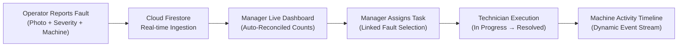

# 🏭 MachAlert

> **Industrial-grade real-time machine fault reporting, activity monitoring, and maintenance management application built with Flutter, Firebase, and Supabase.**

[](https://github.com/kalviumcommunity/SW2627-FlutterFire-MachAlert/actions/workflows/flutter-ci.yml)
[](https://flutter.dev)
[](https://firebase.google.com)
[](https://supabase.com)
[](https://developer.android.com)

---

## 📌 Problem Statement

In modern manufacturing facilities, machine inspections, breakdown events, and operational anomalies are frequently recorded on paper logs or communicated only during end-of-shift handover meetings.

Because machine issues are not reported and acted upon immediately:
- **Unplanned Machine Downtime:** Minor mechanical, electrical, or hydraulic warnings escalate into catastrophic component failures.
- **Communication Breakdown:** Line operators, maintenance technicians, and plant managers operate in information silos.
- **Uncoordinated Maintenance:** Technicians lack detailed fault context, historical breakdown patterns, and photographic proof of the issue.
- **Lost Production Revenue:** Idle machines directly impact manufacturing throughput and plant equipment effectiveness (OEE).

---

## 💡 The MachAlert Solution

MachAlert transforms industrial maintenance from a reactive, paper-heavy routine into an immediate, real-time, event-driven workflow.

Line operators report machine anomalies directly from the factory floor in seconds, complete with machine identification, failure classification, severity ratings, detailed operational notes, and optional photographic proof uploaded to high-performance, secure object storage. Plant managers immediately observe live floor statistics on their dashboards and assign maintenance work orders with linked fault IDs. Technicians receive real-time notifications, access machine history, transition task lifecycles, and record completion proof.



---

## 🚀 Key Features

### 1. Real-Time Fault Reporting & Secure Media Capture
- Instant anomaly capture with machine identification, fault type, and severity matrix (`Low`, `Medium`, `High`, `Critical`).
- Fault images uploaded via **Supabase Storage** with user-scoped isolation paths (`{uid}/{timestamp}_{filename}`).
- Time-limited signed URL generation and strict Row-Level Security (RLS) enforcement.
- Graceful offline fallback: fault reporting succeeds even when photo capture is skipped or network uploads are constrained.

### 2. Human-Readable Reporter Name Resolution
- Fault histories display authentic operator names (e.g., `By Jatin Kashyap`) rather than opaque Firebase UIDs (`By JO5v92NOnFQC1gv...`).
- Multi-tier fallback hierarchy ensures resilient name resolution:
  1. Denormalized `reportedByName` stored directly on `FaultModel`.
  2. Firestore `users/{uid}` cached profile lookup (`displayName` or `name`).
  3. Firebase Auth profile `displayName`.
  4. Firebase Auth `email` prefix.

### 3. Dynamic Real-Time Machine Activity Logs
- Comprehensive chronological machine history synthesized dynamically from Firestore records:
  - **Fault Events:** Fault reported, severity rating, description, reporter identity, and status updates.
  - **Maintenance Events:** Work order assignment, technician allocation, status transitions (`Pending` → `In Progress` → `Resolved`), repair notes, and completion proof references.
- Infinite time-range aggregation without hardcoded data limits or simulated mock entries.

### 4. Interactive Maintenance Task Work Orders
- Searchable, machine-scoped linked fault dropdown: managers can easily associate maintenance work orders with active, eligible open faults on the target machine.
- Technician assignment workflow with status tracking (`Pending`, `In Progress`, `Resolved`, `Cancelled`).
- Technician repair notes, resolution logs, and proof image tracking.

### 5. Manager Dashboard & Live Statistics Reconciliation
- Mathematically consistent machine status categorization:
  $$\text{Total Machines} = \text{Running} + \text{In Maintenance} + \text{Breakdown} + \text{Other}$$
- Real-time Firestore stream listeners reconcile operational counters dynamically without UI lag or stale state.

### 6. Role-Based Access Control (RBAC)
- Strict tripartite access segregation across UI navigation, Cloud Firestore rules, and Supabase Storage policies:
  - **Operator:** Machine inspection, fault submission, and personal report tracking (`My Reports`).
  - **Technician:** Assigned maintenance tasks, fault inspection, status transitions, repair logging.
  - **Manager:** Machine inventory management, fault history oversight, task creation, plant analytics.

### 7. Authentic Reports & Analytics
- Multi-tab industrial report center:
  - **Overview:** Live machine fleet status and severity breakdown.
  - **Inspections:** Transparent, honest state indicating lack of standalone inspection telemetry (no simulated curves).
  - **Breakdowns:** Historical machine failure incident logs with responsive formatting down to 320px compact screens.

### 8. Native Android Launcher Experience
- Clean, brand-aligned launcher icon and home screen label: **`MachAlert`**.

---

## 🛠️ Technology Stack

| Layer | Technologies |
|---|---|
| **Mobile Framework** | [Flutter](https://flutter.dev) (Dart 3.7.0, Material 3) |
| **Authentication** | [Firebase Authentication](https://firebase.google.com/docs/auth) with Custom Claims |
| **Operational Database** | [Cloud Firestore](https://firebase.google.com/docs/firestore) (Real-Time Streams & Indexes) |
| **Media / Object Storage** | [Supabase Storage](https://supabase.com/storage) (S3-compatible, RLS, Signed URLs) |
| **State Management** | [Provider](https://pub.dev/packages/provider) Architecture |
| **Admin Provisioning** | [Node.js](https://nodejs.org) (Firebase Admin SDK v12) |
| **CI / CD Pipeline** | [GitHub Actions](https://github.com/features/actions) (Java 17, Flutter Stable, APK Build) |

---

## 👥 User Roles & Permissions

```
┌─────────────────────────────────────────────────────────────┐
│                       MachAlert RBAC                        │
├─────────────────┬──────────────┬──────────────┬─────────────┤
│ Capability      │ Operator     │ Technician   │ Manager     │
├─────────────────┼──────────────┼──────────────┼─────────────┤
│ View Machines   │ Yes (Read)   │ Yes (Read)   │ Full (CRUD) │
│ Report Faults   │ Yes (Submit) │ Yes (Submit) │ Yes (Submit)│
│ View My Reports │ Yes (Own)    │ Yes (Own)    │ Yes (All)   │
│ View All Faults │ Restricted   │ Yes (Read)   │ Full (Read) │
│ Manage Tasks    │ No           │ Update (Own) │ Full (CRUD) │
│ Upload Images   │ Yes (Own)    │ Yes (Own)    │ Yes (All)   │
│ Access Reports  │ Restricted   │ Restricted   │ Full (Read) │
└─────────────────┴──────────────┴──────────────┴─────────────┘
```

For complete RBAC security rules and policies, see [docs/RBAC.md](docs/RBAC.md).

---

## ⚡ Quick Start & Installation

### Prerequisites
- [Flutter SDK](https://flutter.dev/docs/get-started/install) (`>= 3.29.0`)
- [Java Development Kit](https://adoptium.net) (JDK 17)
- [Android Studio / Android SDK](https://developer.android.com/studio) (API 34+)
- [Node.js](https://nodejs.org) (`>= 20.x`) for administrative scripts

### 1. Clone the Repository
```bash
git clone https://github.com/kalviumcommunity/SW2627-FlutterFire-MachAlert.git
cd SW2627-FlutterFire-MachAlert
```

### 2. Install Dependencies
```bash
flutter pub get
```

### 3. Configure Supabase Storage (Optional for photo uploads)
MachAlert functions with or without Supabase credentials. When provided via compile-time Dart defines, full media storage is enabled:
```bash
flutter run \
  --dart-define=SUPABASE_URL=https://<your-project-id>.supabase.co \
  --dart-define=SUPABASE_ANON_KEY=<your-anon-key> \
  --dart-define=SUPABASE_BUCKET=fault-images
```

### 4. Run Automated Test Suite
```bash
flutter test
```

### 5. Build Android Release APK
```bash
flutter build apk --release
```
The output APK will be generated at `build/app/outputs/flutter-apk/app-release.apk`.

---

## 📚 Complete Documentation Index

- [Setup Guide](docs/SETUP_GUIDE.md) — Comprehensive environment configuration, Firebase, and Supabase guides.
- [System Architecture](docs/ARCHITECTURE.md) — Deep dive into data pipelines, real-time streams, and storage architecture.
- [Role-Based Access Control](docs/RBAC.md) — Permissions matrix, Firestore rules, and Supabase RLS policies.
- [Maintenance Workflow](docs/MAINTENANCE_WORKFLOW.md) — Step-by-step lifecycle from fault ingestion to resolution.
- [CI/CD & Deployment](docs/DEPLOYMENT.md) — Pipeline specifications, Android signing, and release procedures.
- [Known Limitations](docs/KNOWN_LIMITATIONS.md) — Transparent inventory of operational boundaries and future roadmap.
- [Full QA Audit Report](docs/QA/MACHALERT_FULL_RELEASE_QA_REPORT.md) — Comprehensive test coverage and verification results.

---

## 📄 License
This project is proprietary and confidential. Developed under the Kalvium Community industrial software initiative.
