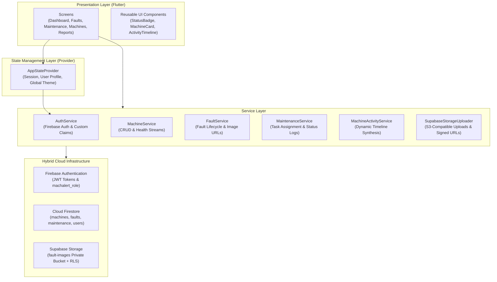
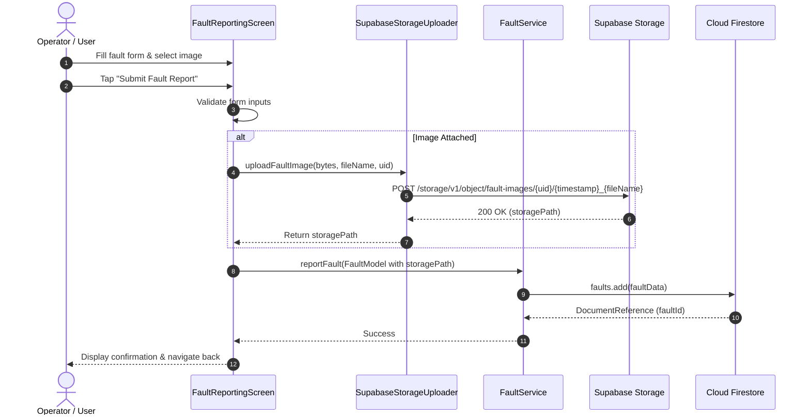
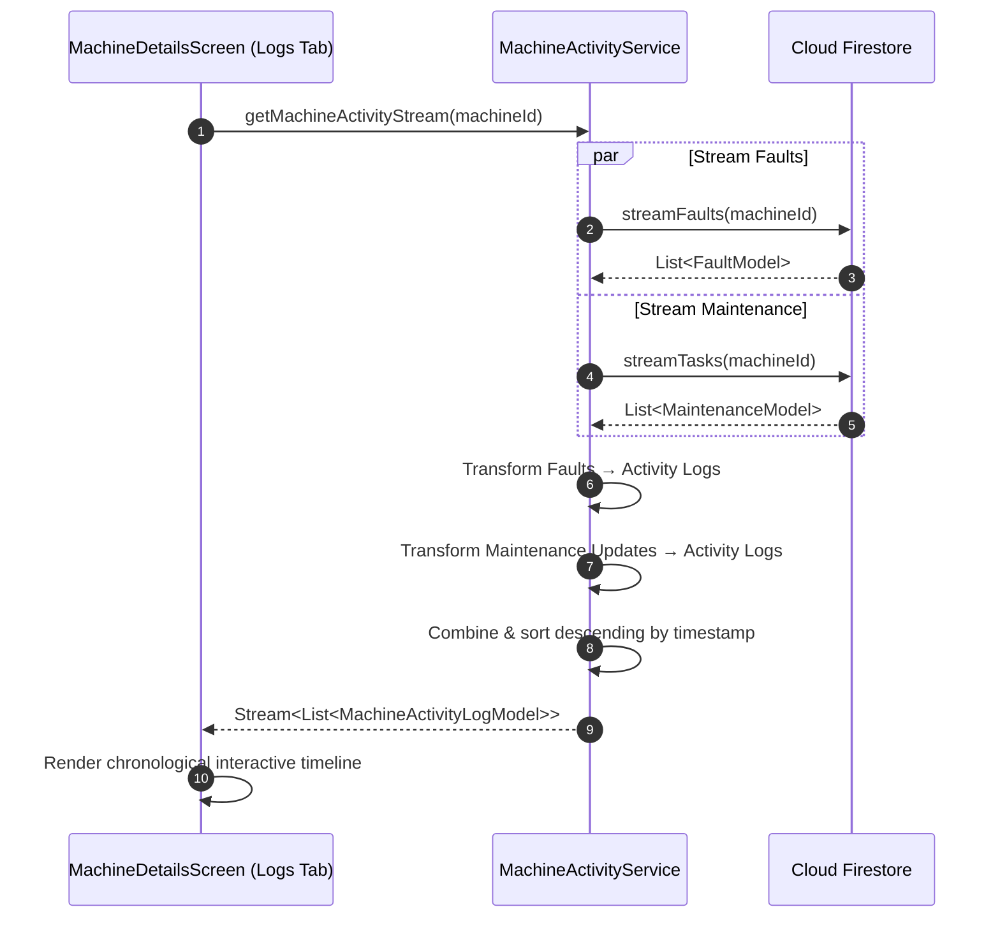
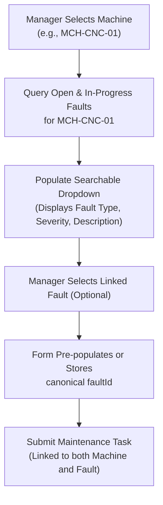
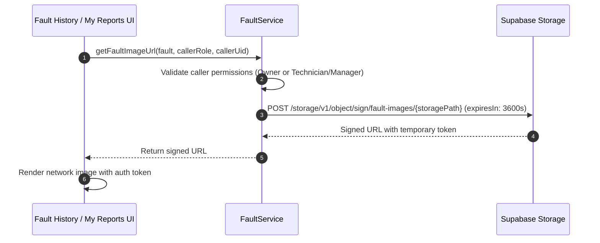

# 🏗️ MachAlert System Architecture & Design

This document details the architectural patterns, data pipelines, hybrid cloud storage integration, real-time synchronization mechanisms, and component interactions that power the MachAlert platform.

---

## 1. High-Level Architecture Overview

MachAlert employs a modern **Layered Reactive Architecture** built on Flutter and a hybrid cloud backend leveraging **Google Firebase** for identity and document state, alongside **Supabase Storage** for secure binary asset handling.



---

## 2. Layered Component Responsibilities

### A. Presentation Layer (`lib/screens/`, `lib/widgets/`)
- Pure Flutter UI declarative widgets implementing Material 3 styling.
- Responsive layout adaptations supporting screen viewports from 320px compact mobile screens to large tablets.
- Consumes service streams via `StreamBuilder` and `Consumer<AppStateProvider>` to maintain zero-drift state synchronization.

### B. State Management Layer (`lib/providers/`)
- Manages application-wide session state, user authentication status, authenticated role metadata, and active theme modes.
- `AppStateProvider` holds the current `UserModel` and notifies descendant listeners upon authentication state transitions.

### C. Service Layer (`lib/services/`)
- Encapsulates business logic, validation rules, query execution, and network error handling.
- Exposes typed reactive streams (`Stream<List<T>>`) and async operations (`Future<T>`).
- Completely decouples the UI from direct third-party SDK dependencies (Firebase, Supabase).

### D. Data & Model Layer (`lib/models/`)
- Immutable Dart models with strict serialization/deserialization methods (`fromFirestore`, `toFirestore`, `fromJson`, `toJson`).
- Strongly typed domain entities:
  - `MachineModel` & `MachineStatistics`
  - `FaultModel`
  - `MaintenanceModel` & `MaintenanceUpdateModel`
  - `MachineActivityLogModel`
  - `UserModel`

---

## 3. Hybrid Cloud Infrastructure Design

MachAlert implements a hybrid cloud architecture combining the best-in-class features of Firebase and Supabase:

```
┌─────────────────────────────────────────────────────────────────┐
│                      Hybrid Cloud Division                      │
├───────────────────────────────┬─────────────────────────────────┤
│ Google Firebase               │ Supabase                        │
├───────────────────────────────┼─────────────────────────────────┤
│ • User Authentication         │ • Binary Media Asset Storage    │
│ • Custom Claims JWT Tokens    │ • User-Prefix Folder Isolation  │
│ • Cloud Firestore Documents   │ • Row-Level Security (RLS)      │
│ • Real-time Stream Listeners  │ • Time-Limited Signed URLs      │
│ • Composite Indexing          │ • S3-Compatible REST Endpoints  │
└───────────────────────────────┴─────────────────────────────────┘
```

### Why Hybrid?
1. **Low-Latency Metadata:** Firestore provides unmatched reactive document streaming for real-time mobile UI synchronization.
2. **Predictable Media Storage:** Supabase provides high-throughput S3-compatible binary storage with standard PostgreSQL Row-Level Security (RLS) policies, eliminating proprietary storage lock-in.

---

## 4. End-to-End Data Pipelines

### A. Fault Reporting & Media Upload Pipeline



### B. Machine Activity Timeline Synthesis

The Machine Activity timeline does not rely on a static logs table. Instead, `MachineActivityService` dynamically synthesizes and sorts events across multiple Firestore streams in real time:



---

## 5. Maintenance Task Assignment with Linked Faults

When assigning a maintenance work order, managers can optionally link an existing active fault belonging to the machine:



---

## 6. Manager Dashboard Statistics Reconciliation

To prevent mathematical discrepancies across the manager dashboard, `MachineStatistics` enforces exact partitioning:

$$\text{Total Machines} = \text{Running} + \text{In Maintenance} + \text{Breakdown} + \text{Other}$$

Status mappings are strictly normalized:
- **Running:** `Operational`, `Running`
- **In Maintenance:** `Under Maintenance`, `In Maintenance`
- **Breakdown:** `Critical`, `Breakdown`, `Broken`
- **Other:** `Warning`, `Offline`, `Unknown`

---

## 7. Storage Security & Image URL Resolution

Fault images are stored in a private bucket (`fault-images`). Image access requires an authenticated signed URL:


