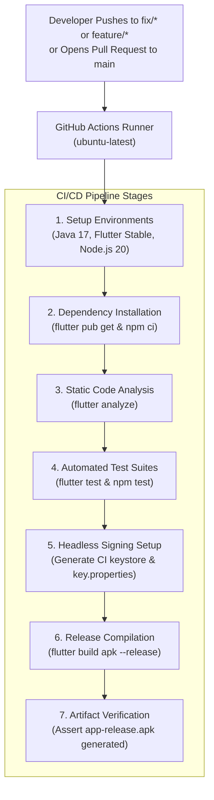

# 🚀 MachAlert CI/CD & Deployment Guide

This document outlines the automated Continuous Integration and Continuous Deployment (CI/CD) pipelines, branching models, Android signing configurations, and production release procedures for the MachAlert mobile application.

---

## 1. CI/CD Architecture Overview

MachAlert utilizes **GitHub Actions** for automated quality assurance, static analysis, unit/widget testing, administrative script validation, and Android release compilation.



---

## 2. GitHub Actions Workflow Configuration

The primary workflow is located at `.github/workflows/flutter-ci.yml`.

### Triggers
- **Push:** To `main`, `fix/*`, and `feature/*` branches.
- **Pull Request:** Targeting `main`.

### Key Pipeline Steps

```yaml
# 1. Environment Provisioning
- uses: actions/setup-java@v4
  with:
    distribution: 'temurin'
    java-version: '17'

- uses: subosito/flutter-action@v2
  with:
    channel: 'stable'
    cache: true

- uses: actions/setup-node@v4
  with:
    node-version: '20'

# 2. Quality & Analysis Gates
- run: flutter pub get
- run: flutter analyze

# 3. Test Suites Execution
- run: flutter test
- run: |
    cd scripts/admin
    npm ci
    npm test
    cd ../..

# 4. Headless Keystore Injection for Release Build
- run: |
    KEYSTORE_PATH="$(pwd)/android/app/ci-release.keystore"
    keytool -genkeypair -v -keystore "$KEYSTORE_PATH" \
      -alias cikey -keyalg RSA -keysize 2048 -validity 10000 \
      -storepass cisecret -keypass cisecret \
      -dname "CN=MachAlert CI, OU=Engineering, O=MachAlert, C=US"
    cat <<EOF > android/key.properties
    storePassword=cisecret
    keyPassword=cisecret
    keyAlias=cikey
    storeFile=$KEYSTORE_PATH
    EOF

# 5. Release APK Compilation
- run: flutter build apk --release
- run: test -f build/app/outputs/flutter-apk/app-release.apk
```

---

## 3. Branching & Release Strategy

MachAlert follows a structured Git feature-branching workflow:

```
main (Production / Stable Releases)
  ▲
  │ (Pull Request Review & CI Passing)
  ├────────────────────────┐
  │                        │
fix/dashboard-workflows  feature/machine-activity-logs
```

1. **`main`:** Production-grade trunk. Direct pushes are protected; all changes must merge via reviewed Pull Requests with passing CI checks.
2. **`feature/*`:** Scoped feature development branches (e.g., `feature/machine-activity-logs`).
3. **`fix/*`:** Bug fixes and remediation branches (e.g., `fix/dashboard-and-fault-workflows`).

---

## 4. Production Android Release Signing

While CI builds use a transient self-signed keystore to verify compilation, official production releases must be signed using the team's official upload keystore.

### Step 1: Secure Keystore Management
- Keep your production keystore (`machalert-upload.jks`) stored securely in a hardware security module, password manager, or encrypted secret store.
- **NEVER** commit keystores or `key.properties` to source control.

### Step 2: Local Production Build
1. Ensure `android/key.properties` points to your authentic production keystore:
   ```properties
   storeFile=/Users/admin/.machalert/machalert-upload.jks
   storePassword=secure_production_password
   keyAlias=machalert-upload
   keyPassword=secure_production_password
   ```
2. Execute the production compilation:
   ```bash
   flutter build apk --release
   ```
3. Verify the generated APK's package name and launcher label:
   ```bash
   aapt dump badging build/app/outputs/flutter-apk/app-release.apk | grep -E "package|application-label"
   ```
   **Expected Output:**
   ```text
   package: name='com.example.mach_alert' versionCode='3' versionName='1.0.0'
   application-label:'MachAlert'
   ```

---

## 5. Pre-Release Verification Checklist

Before creating a production release tag or publishing an APK:

- [ ] All GitHub Actions checks pass on the target pull request.
- [ ] `flutter analyze` reports 0 issues.
- [ ] `flutter test` reports 977 passing tests.
- [ ] `node scripts/admin/test/provision_supabase_claims.test.js` reports 12 passing tests.
- [ ] `android/app/src/main/res/values/strings.xml` defines `app_name` as `MachAlert`.
- [ ] `android/app/src/main/AndroidManifest.xml` references `android:label="@string/app_name"`.
- [ ] Release APK compiles cleanly and outputs to `build/app/outputs/flutter-apk/app-release.apk`.
- [ ] Application installs and opens on a physical Android device without crashing.
