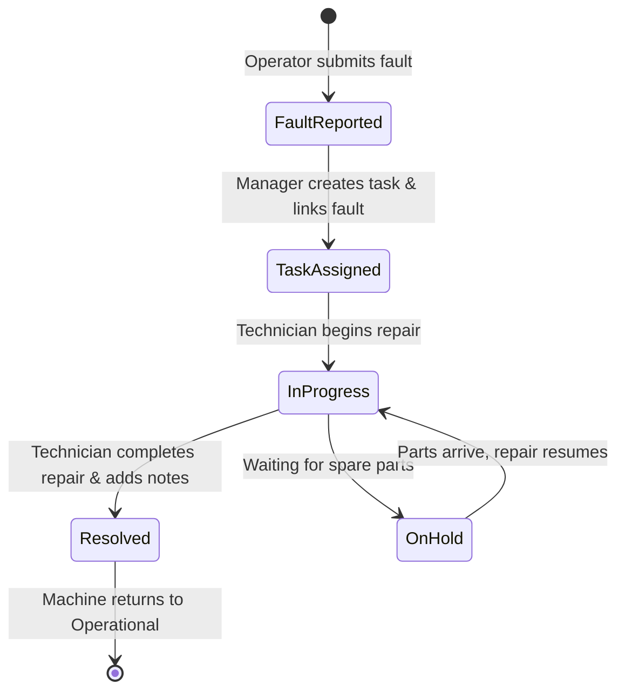

# 🔧 MachAlert End-to-End Maintenance Workflow Guide

This document provides a comprehensive operational guide to the complete machine maintenance lifecycle in MachAlert, from initial anomaly reporting on the shop floor to final resolution and real-time activity logging.

---

## 1. Lifecycle Overview



---

## 2. Step-by-Step Workflow Walkthrough

### Phase 1: Anomaly Detection & Immediate Reporting (Operator)
1. **Detection:** An operator notices an operational anomaly (e.g., abnormal spindle vibration, hydraulic fluid leak, electrical sensor fault).
2. **Access Reporting Form:** Operator taps the floating **Report Fault** action button on the dashboard or navigates to `/faults/report`.
3. **Machine Selection:** Operator selects the affected machine from the machine dropdown.
4. **Classification:**
   - **Type:** `Mechanical`, `Electrical`, `Hydraulic`, `Pneumatic`, `Software`, `Other`.
   - **Severity:** `Low`, `Medium`, `High`, or `Critical`.
5. **Photo Evidence (Optional):**
   - Operator takes a photo using the device camera or selects from gallery.
   - The image is uploaded directly to Supabase Storage under `{uid}/{timestamp}_{filename}`.
6. **Submission:**
   - The form resolves the operator's display name (`reportedByName`) from Firestore profile or Auth metadata.
   - Fault document is written to the `faults` Firestore collection.
   - Operator receives an instant confirmation and can monitor the report under **My Reports**.

---

### Phase 2: Manager Triage & Work Order Assignment (Manager)
1. **Live Dashboard Update:**
   - The manager's dashboard updates in real time via Firestore streams.
   - Machine status counters immediately reflect the updated fleet health score.
2. **Work Order Creation:**
   - Manager navigates to **Maintenance** tab and taps **Assign Task**.
3. **Machine Selection:**
   - Manager selects the affected machine (e.g., `5-Axis CNC Milling Center`).
4. **Searchable Linked Fault Dropdown:**
   - Selecting a machine queries and filters all active, eligible faults (`Open` or `In Progress`) for that specific machine.
   - Manager selects the relevant fault from the dropdown. The dropdown presents the fault's description, severity badge, and fault ID.
5. **Technician Allocation:**
   - Manager selects an available qualified technician from the technician roster.
   - Sets priority (`Low`, `Medium`, `High`, `Urgent`) and scheduled completion target.
6. **Task Ingestion:**
   - Task is written to the `maintenance` Firestore collection with status `Pending` and linked `faultId`.

---

### Phase 3: Work Order Execution (Technician)
1. **Task Notification & Inspection:**
   - The technician logs in and views their assigned work orders in the **Maintenance Tasks** list.
   - Tapping the task opens the full work order details, including machine specs, linked fault description, and attached fault images (accessed securely via time-limited signed URLs).
2. **Reviewing Machine History:**
   - Technician navigates to the machine's **Activity Logs** tab.
   - Reviews historical breakdowns, past maintenance notes, and recurring failure trends.
3. **Status Transition to "In Progress":**
   - When arriving at the machine, the technician taps **Start Work**.
   - The task status transitions from `Pending` to `In Progress`.
   - An entry is automatically appended to `updateHistory` with timestamp and technician ID.

---

### Phase 4: Resolution & Verification (Technician)
1. **Repair Execution:**
   - Technician performs the required mechanical adjustments, part replacements, or recalibrations.
2. **Repair Notes & Proof:**
   - Technician enters detailed technical notes (e.g., *"Replaced worn ceramic spindle bearing and calibrated dynamic runout to within 0.002 mm"*).
   - Optionally takes a photo of the completed repair.
3. **Status Transition to "Resolved":**
   - Technician taps **Complete Task**.
   - Task transitions to `Resolved`.
   - The linked fault status is automatically updated to `Resolved`.
   - The machine's operational status returns to `Operational` / `Running`, and health score recalculates.

---

### Phase 5: Dynamic Real-Time Machine Activity Logging

Every event throughout the maintenance lifecycle is dynamically streamed and aggregated into the machine's chronological timeline on `MachineDetailsScreen`:

| Event Type | Source | Rendered Timeline Data |
|---|---|---|
| **Fault Reported** | `faults` collection | Reporter name, severity badge, description, image thumbnail link. |
| **Task Created** | `maintenance` collection | Priority, initial instructions, assigned technician. |
| **In Progress Transition** | `updateHistory` | Technician start timestamp and initial diagnostic notes. |
| **Repair Completed** | `updateHistory` | Final repair notes, resolution timestamp, proof image reference. |

---

## 3. Maintenance Status Transition Rules

```
┌─────────────────────────────────────────────────────────────┐
│                    Status Transition State                  │
├─────────────────┬──────────────────┬────────────────────────┤
│ From Status     │ Allowed To       │ Required Input         │
├─────────────────┼──────────────────┼────────────────────────┤
│ Pending         │ In Progress      │ Technician Confirmation│
│ Pending         │ Cancelled        │ Manager Notes          │
│ In Progress     │ Resolved         │ Repair Notes (Required)│
│ In Progress     │ On Hold          │ Reason for delay       │
│ On Hold         │ In Progress      │ Resumption Notes       │
│ Resolved        │ Re-opened        │ Manager Justification  │
└─────────────────┴──────────────────┴────────────────────────┘
```
