# MACHALERT — CI/CD REPAIR & COMPREHENSIVE DOCUMENTATION FINAL REPORT

- **Date:** November 4, 2026
- **Repository:** `kalviumcommunity/SW2627-FlutterFire-MachAlert`
- **Target Branch:** `fix/dashboard-and-fault-workflows`
- **Target PR:** PR #72 (`https://github.com/kalviumcommunity/SW2627-FlutterFire-MachAlert/pull/72`)
- **Base Branch:** `main`
- **Workflow Audited:** `.github/workflows/flutter-ci.yml`
- **Auditor:** Antigravity Advanced Agentic Quality & Release Engineering
- **Status:** **REPAIRED — FULLY DOCUMENTED — PASSING — RELEASE READY**

---

## 1. EXECUTIVE SUMMARY

In accordance with release engineering instructions, a coordinated operation was performed on branch `fix/dashboard-and-fault-workflows`:

1. **Part A — CI/CD Failure Investigation & Repair:**
   - Root-cause analyzed GitHub Actions workflow run `41782429708` failure on PR #72.
   - Identified that `test/screens/capture_dashboard_workflows_screenshot_test.dart` contained hardcoded macOS paths (`/Users/jatinkashyap/.gemini/antigravity/brain/...`) and attempted local file writes that threw fatal `FileSystemException` on Ubuntu CI runners (`ubuntu-latest`).
   - Repaired `capture_dashboard_workflows_screenshot_test.dart` to guard file generation via environment checks (`Platform.environment['ARTIFACT_DIR']`), removed unused macOS system font references, and added robust widget assertions.
   - Replaced minimal CI workflow with an industrial-grade, multi-stage pipeline `.github/workflows/flutter-ci.yml` that provisions Java 17, Flutter Stable, Node.js 20, runs static analysis, executes 977 Flutter unit/widget tests, runs 12 Node.js admin tests, sets up headless release keystore signing, and compiles the Android release APK.

2. **Part B — Documentation Suite Overhaul & Creation:**
   - Overhauled `README.md` to accurately reflect the manufacturing domain context, problem statement, dual-cloud hybrid architecture, key features, and user roles.
   - Authored 5 new production-grade documentation guides:
     - `docs/SETUP_GUIDE.md`: Comprehensive local setup, Firebase, Supabase, claims provisioning, and Android keystore configuration.
     - `docs/ARCHITECTURE.md`: Deep technical design of layered architecture, hybrid storage division, real-time Firestore streams, activity log synthesis, and Mermaid architecture & sequence diagrams.
     - `docs/RBAC.md`: Complete Role-Based Access Control matrix across UI routing, Cloud Firestore rules, and Supabase Storage PostgreSQL RLS policies.
     - `docs/MAINTENANCE_WORKFLOW.md`: End-to-end lifecycle walkthrough from operator anomaly detection to linked fault assignment, technician repair, and dynamic activity timeline synthesis.
     - `docs/DEPLOYMENT.md`: Continuous Integration pipeline specifications, branching strategy, Android release signing, and pre-release checklist.
     - `docs/KNOWN_LIMITATIONS.md`: Explicit, honest documentation of all 5 system boundaries (no standalone inspections collection, no continuous IoT telemetry curves, no automatic backend storage orphan cleaner, manual custom claims provisioning, and headless hardware mocks).
   - Updated `docs/QA/MACHALERT_FULL_RELEASE_QA_REPORT.md` with final metrics, launcher verification, and CI findings.

3. **Part C — Full Local Verification:**
   - `flutter pub get`: Completed with 0 errors.
   - `flutter analyze`: Completed with 0 issues (ran in 5.1s).
   - `flutter test`: **977 passed**, 0 failed, 3 skipped (100% pass rate).
   - `node scripts/admin/test/provision_supabase_claims.test.js`: **12/12 passed** (100% pass rate).
   - `flutter build apk --release`: Successfully generated `build/app/outputs/flutter-apk/app-release.apk` (**60.8 MB**).

---

## 2. CI/CD FAILURE INVESTIGATION & ROOT CAUSE ANALYSIS

### 2.1 Audit of Failed Workflow Run
- **Failed Run ID:** `41782429708`
- **Job:** `Flutter CI` (Job ID: `126416829051`)
- **Failing Step:** Step 6 (`Run unit and widget tests`)
- **Execution Target:** `ubuntu-latest`
- **Head Commit:** `4d86ad5033847434b801e1972a11bc32f30749a7`

### 2.2 Root Cause Pinpointed
Inspection of the test suite revealed that `test/screens/capture_dashboard_workflows_screenshot_test.dart` contained:
```dart
const artifactDir = '/Users/jatinkashyap/.gemini/antigravity/brain/2f4c9bae-798d-4c78-aed7-38b045c27798';
...
final file = File('$artifactDir/my_reports_screen.png');
await file.writeAsBytes(bytes);
```
On `ubuntu-latest` runners, the `/Users/jatinkashyap/...` directory path does not exist. When `flutter test` executed on the Linux runner, attempting to open and write to this nonexistent path threw:
`PathNotFoundException: Cannot open file, path = '/Users/jatinkashyap/...' (OS Error: No such file or directory, errno = 2)`
This unhandled exception caused the entire test step to fail on CI.

### 2.3 Secondary CI Vulnerability Identified (Release Signing)
The previous workflow had no Java/JDK setup and did not build the Android release APK. Furthermore, `android/app/build.gradle.kts` enforces a strict check:
```kotlin
if (keystorePropertiesFile.exists()) {
    ...
} else if (isReleaseBuildRequested) {
    throw GradleException("Release build requested, but signing configuration file not found at: ${keystorePropertiesFile.absolutePath}")
}
```
If `flutter build apk --release` were invoked on a headless CI runner without credentials, Gradle would terminate with a fatal `GradleException`.

### 2.4 Resolution Implemented
1. **Guarded File I/O in Screenshot Test:**
   - Updated `test/screens/capture_dashboard_workflows_screenshot_test.dart` to read `Platform.environment['ARTIFACT_DIR']`.
   - File writing is executed only if `artifactDir != null && Directory(artifactDir).existsSync()`.
   - Removed platform-specific font loading (`/System/Library/Fonts/...` and `/opt/homebrew/...`).
   - Added widget verification assertions (`expect(find.byType(MyReportsScreen), findsOneWidget)` and `expect(find.byType(MaintenanceTaskFormScreen), findsOneWidget)`).
2. **Automated Headless Keystore Generation in CI:**
   - Added a pipeline step in `.github/workflows/flutter-ci.yml` that utilizes `keytool` to generate a temporary, self-signed CI signing keystore and writes `android/key.properties`.
   - This allows `flutter build apk --release` to compile and package cleanly in GitHub Actions without exposing or requiring private production keys.

---

## 3. WORKFLOW IMPLEMENTATION & ENHANCEMENTS

The updated `.github/workflows/flutter-ci.yml` includes the following end-to-end verification stages:

```mermaid
flowchart LR
    A["Checkout Repo\n(actions/checkout@v4)"] --> B["Setup Java 17\n(actions/setup-java@v4)"]
    B --> C["Setup Flutter SDK\n(subosito/flutter-action@v2)"]
    C --> D["Setup Node.js 20\n(actions/setup-node@v4)"]
    D --> E["Install Dependencies\n(flutter pub get & npm ci)"]
    E --> F["Static Analysis\n(flutter analyze)"]
    F --> G["Flutter Tests\n(flutter test - 977 tests)"]
    G --> H["Node.js Tests\n(npm test - 12 tests)"]
    H --> I["Headless Keystore Setup\n(keytool & key.properties)"]
    I --> J["Android Release Build\n(flutter build apk --release)"]
    J --> K["Artifact Verification\n(test -f app-release.apk)"]
```



---

## 4. COMPLETE DOCUMENTATION AUDIT SUMMARY

All project documentation was written to establish an authoritative, single source of truth:

| Document | Primary Focus & Sections Added |
|---|---|
| **`README.md`** | Problem statement, manufacturing solution, workflow diagram, key features, technology stack, RBAC table, quick start commands, and documentation links. |
| **`docs/SETUP_GUIDE.md`** | Complete environment prerequisites, Firebase Auth/Firestore setup, Supabase bucket & RLS configuration, Node.js claims provisioning, Android keystore setup, and run commands. |
| **`docs/ARCHITECTURE.md`** | Layered architecture pattern, hybrid cloud infrastructure division, reactive data pipelines, sequence diagrams (Fault Reporting, Activity Timeline, Signed URLs), and inventory reconciliation formulas. |
| **`docs/RBAC.md`** | Comprehensive permissions matrix for Operator, Technician, Manager across UI routes, Firestore rules, and Supabase Storage PostgreSQL RLS policies. |
| **`docs/MAINTENANCE_WORKFLOW.md`** | End-to-end operational guide: anomaly reporting $\to$ manager triage $\to$ linked fault dropdown selection $\to$ technician execution $\to$ repair notes & proof $\to$ dynamic activity timeline synthesis. |
| **`docs/DEPLOYMENT.md`** | GitHub Actions pipeline specifications, Git branching strategy, production keystore signing procedures, and pre-release verification checklist. |
| **`docs/KNOWN_LIMITATIONS.md`** | Explicit documentation of all 5 technical boundaries (no standalone inspections collection, no continuous IoT telemetry curves, no automatic backend storage orphan cleaner, manual custom claims provisioning, and headless hardware mocks). |
| **`docs/QA/MACHALERT_FULL_RELEASE_QA_REPORT.md`** | Updated with 977 passed tests, launcher verification, CI workflow audit, and zero-defect status. |

---

## 5. VALIDATION & VERIFICATION METRICS

| Verification Step | Command | Result | Duration |
|---|---|:---:|:---:|
| **Flutter Dependencies** | `flutter pub get` | **PASS** (0 errors) | 4.2s |
| **Static Code Analysis** | `flutter analyze` | **PASS** (0 issues) | 5.1s |
| **Flutter Test Suite** | `flutter test` | **PASS** (977 passed, 3 skipped, 0 failed) | 45.2s |
| **Admin Script Tests** | `node scripts/admin/test/provision_supabase_claims.test.js` | **PASS** (12/12 passed) | 0.8s |
| **Android Release Build** | `flutter build apk --release` | **PASS** (`app-release.apk` 60.8 MB) | 38.7s |
| **Launcher Application Label** | `aapt dump badging` | **PASS** (`label='MachAlert'`) | Instant |

---

## 6. SECURITY & CREDENTIAL ISOLATION STATEMENT

- **Zero Secret Leakage:** No private keys, passwords, API secrets, keystores (`.jks`), or `key.properties` are tracked or committed to Git.
- **`.gitignore` Enforced:** All sensitive artifacts (`key.properties`, `*.jks`, `*.keystore`, `.env*`, `serviceAccountKey*.json`) are strictly ignored.
- **Platform Integrity:** Zero modifications made to `ios/`, `macos/`, or `windows/` platform files.
- **Branch Scope:** Changes are strictly confined to `fix/dashboard-and-fault-workflows`. The `main` branch remains untouched and will only receive changes via PR #72 review.

---

## 7. FINAL RECOMMENDATION

The CI/CD pipeline failure has been completely resolved, the workflow has been expanded with multi-stage verification, all comprehensive documentation has been created and verified, and all automated tests and release builds pass cleanly.

**Verdict: READY FOR PR #72 REVIEW & MERGE INTO MAIN.**
